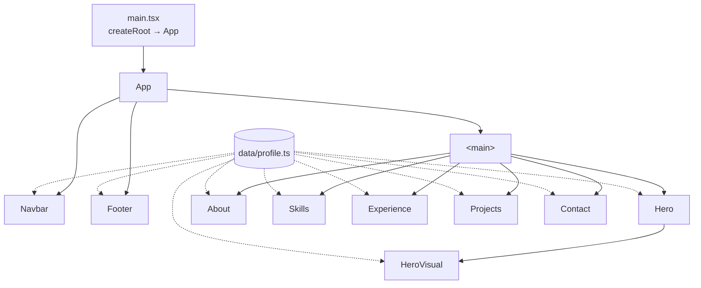

# 01 – Overview

## Purpose

A single-page personal portfolio for **Sudhanshu Kumar (Full Stack Developer)**, aimed at recruiters. It presents an intro, about, skills, work experience, projects and contact details on one scrolling page.

It is a **static site**: no backend, no database, no API calls at runtime. Everything is bundled at build time and can be hosted on any static host (Vercel, Netlify, GitHub Pages).

## Tech stack

| Concern | Choice | Version (package.json) |
|---|---|---|
| UI library | React | ^19.2.8 |
| Language | TypeScript | ~6.0.2 |
| Build tool / dev server | Vite (+ `@vitejs/plugin-react`) | ^8.3.0 |
| Styling | Tailwind CSS v4 (via `@tailwindcss/vite`) | ^4.3.3 |
| Animation | Framer Motion | ^14.2.0 |
| UI icons | Phosphor Icons (`@phosphor-icons/react`) | ^2.1.10 |
| Linting | ESLint + typescript-eslint + react-hooks | ^10.10.0 |
| Fonts | Inter, Plus Jakarta Sans (Google Fonts, loaded in `index.html`) | — |

`lucide-react` is still listed as a dependency but is **not imported anywhere** (see [08 – Known issues](08-known-issues.md)).

## Folder structure

```
.
├── architecture/          ← these docs
├── index.html             ← HTML shell: title, meta tags, favicon, Google Fonts
├── public/
│   └── favicon.png        ← round "S" logo used as the browser-tab icon
├── src/
│   ├── main.tsx           ← React entry; mounts <App/> in StrictMode
│   ├── App.tsx            ← page composition (section order lives here)
│   ├── index.css          ← Tailwind import, theme tokens, global styles
│   ├── data/
│   │   └── profile.ts     ← ALL editable content (single source of truth)
│   ├── components/
│   │   ├── index.ts       ← barrel export of section components
│   │   ├── Navbar.tsx     ← floating pill navigation
│   │   ├── Hero.tsx       ← intro + typewriter role + CTA
│   │   ├── HeroVisual.tsx ← animated framed image + floating cards
│   │   ├── About.tsx      ← story, strengths, dark profile card
│   │   ├── Skills.tsx     ← skill chips with logos
│   │   ├── Experience.tsx ← company/role cards
│   │   ├── Projects.tsx   ← project cards
│   │   ├── Contact.tsx    ← dark CTA panel + channels
│   │   ├── Footer.tsx
│   │   ├── Section.tsx    ← shared section wrapper (eyebrow/title/subtitle)
│   │   ├── Highlighted.tsx← renders **bold** markers in data strings
│   │   └── TechLogo.tsx   ← technology name → logo
│   ├── utils/
│   │   └── scroll.ts      ← smooth-scroll to a section id
│   └── assets/
│       ├── logo.png       ← "S" logo (navbar)
│       ├── hero.webp      ← hero image used on the site (63 KB)
│       ├── Hero.png       ← original 1.7 MB source of hero.webp (not bundled)
│       └── tech/*.svg     ← technology logos
└── vite.config.ts         ← React + Tailwind plugins
```

## How the page is assembled

`App.tsx` renders the sections in a fixed order inside a full-height gradient wrapper (`from-blue-100 to-red-100`):



- **Navigation** is in-page only. Each section has an `id` (`hero`, `about`, `skills`, `experience`, `projects`, `contact`); the navbar scrolls to it with `scrollIntoView({ behavior: 'smooth' })`. There is no router.
- `html { scroll-padding-top: 6.5rem }` in `index.css` keeps section headings from hiding under the fixed navbar.
- To **reorder sections**, change the order in `App.tsx`. To **add one to the navbar**, also add it to the `Links` array in `Navbar.tsx` (its `id` must match the section's `id`).

## Responsive strategy

Mobile-first Tailwind classes. Key breakpoints in use:

| Breakpoint | Width | What changes |
|---|---|---|
| default | < 640px | single column; hero image hidden; navbar shows hamburger menu |
| `sm` | ≥ 640px | more padding; panel icon tiles appear in Experience |
| `md` | ≥ 768px | Experience focus panels go two-up |
| `lg` | ≥ 1024px | two-column Hero and About; full navbar links; hero image shown |
| `xl` | ≥ 1280px | larger headings and wider column gaps |
